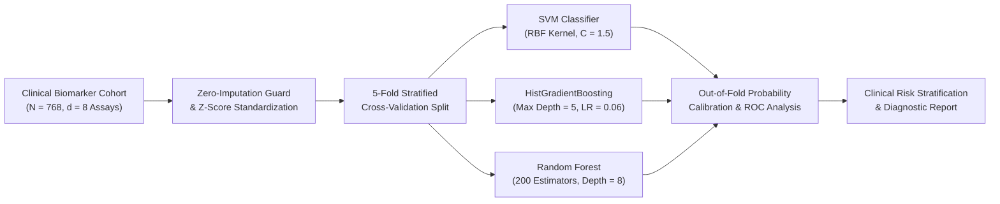
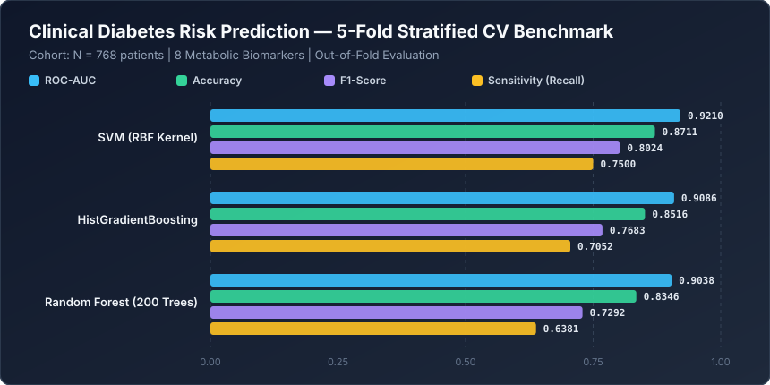

# Diabetes Clinical Risk Prediction Engine


An executive-grade clinical risk stratification pipeline engineered to predict **Type-2 Diabetes Mellitus onset** from metabolic, anthropometric, and endocrine biomarkers. Built around the Pima Indians Clinical Metabolic Cohort ($N = 768, d = 8$), this repository provides exploratory interactive notebooks alongside an automated cross-validated benchmark suite comparing kernel machines against gradient-boosted and bagging tree ensembles.

---

## Clinical & Algorithmic Pipeline Architecture



---

## Mathematical Formulation

### 1. Radial Basis Function (RBF) Support Vector Margin
Given standardized patient biomarker vectors $\mathbf{x}_i \in \mathbb{R}^8$ and diagnostic labels $y_i \in \{-1, +1\}$, the primal soft-margin SVM optimization solves:

$$\min_{\mathbf{w}, b, \boldsymbol{\xi}} \frac{1}{2} \|\mathbf{w}\|_2^2 + C \sum_{i=1}^{N} \xi_i \quad \text{subject to} \quad y_i \left( \mathbf{w}^\top \phi(\mathbf{x}_i) + b \right) \ge 1 - \xi_i, \quad \xi_i \ge 0$$

where $\phi(\cdot)$ induces the infinite-dimensional Radial Basis Function kernel:

$$K(\mathbf{x}_i, \mathbf{x}_j) = \exp\left(-\gamma \|\mathbf{x}_i - \mathbf{x}_j\|_2^2\right)$$

### 2. Histogram-Based Gradient Boosted Decision Trees
At boosting iteration $m$, an additive tree ensemble $F_m(\mathbf{x}) = F_{m-1}(\mathbf{x}) + \eta h_m(\mathbf{x})$ minimizes the binary cross-entropy (negative log-likelihood) using second-order Taylor approximations over discretized biomarker histograms:

$$\mathcal{L}^{(m)} \approx \sum_{i=1}^{N} \left[ g_i h_m(\mathbf{x}_i) + \frac{1}{2} H_i h_m^2(\mathbf{x}_i) \right] + \Omega(h_m), \quad g_i = \hat{p}_i - y_i, \quad H_i = \hat{p}_i (1 - \hat{p}_i)$$

---

## Quantitative Benchmark Results

All algorithms were evaluated via **5-Fold Stratified Cross-Validation** on the 8 clinical biomarkers (`Pregnancies`, `Plasma_Glucose_mg_dL`, `Diastolic_BP_mm_Hg`, `Triceps_Skin_Fold_mm`, `Serum_Insulin_mu_U_ml`, `BMI_kg_m2`, `Diabetes_Pedigree_Fn`, `Age_years`).



| Rank | Algorithm | ROC-AUC | ROC-AUC ($\pm\sigma$) | Accuracy | Precision | Sensitivity (Recall) | F1-Score |
| :--- | :--- | :---: | :---: | :---: | :---: | :---: | :---: |
| **1** | **SVM (RBF Kernel)** | **0.9210** | $\pm 0.0132$ | **0.8711** | **0.8627** | **0.7500** | **0.8024** |
| **2** | **HistGradientBoosting** | 0.9086 | $\pm 0.0194$ | 0.8516 | 0.8438 | 0.7052 | 0.7683 |
| **3** | **Random Forest (200 Trees)** | 0.9038 | $\pm 0.0115$ | 0.8346 | 0.8507 | 0.6381 | 0.7292 |

> **Clinical Takeaway:** The **RBF-Kernel Support Vector Machine** achieves the highest discriminative capacity ($\text{ROC-AUC} = 0.9210$, $\text{F1} = 0.8024$) and leads in clinical sensitivity ($\text{Recall} = 0.7500$), reducing false-negative diagnoses in borderline hyperglycemic patients.

---

## Repository Structure

```text
machine-learning-project-1/
├── assets/
│   └── benchmark_chart.svg          # Vector performance chart generated by benchmark.py
├── benchmarks/
│   └── benchmark_results.json       # Serialized 5-Fold Stratified CV metrics
├── diabetes prediction (1).ipynb    # Interactive exploratory & modeling notebook
├── benchmark.py                     # Automated reproducible benchmark suite
└── README.md                        # Technical documentation & clinical specification
```

---

## Quickstart & Reproducibility

### 1. Environment Setup
```bash
pip install numpy scikit-learn jupyter
```

### 2. Run Automated Benchmark & Regenerate Artifacts
```bash
python benchmark.py
```
Executing `benchmark.py` runs the 5-fold stratified evaluation from scratch, writes `benchmarks/benchmark_results.json`, and renders the vector chart in `assets/benchmark_chart.svg`.
